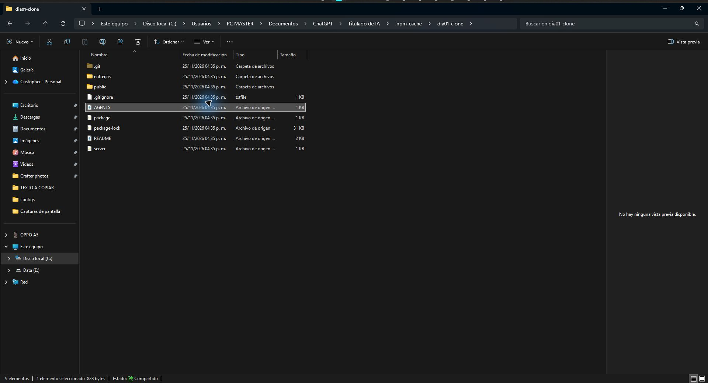

# Día 1 — Creación del repositorio e instrucciones

## Repositorio y alcance

- Repositorio público: https://github.com/Master6869/mini-inventario
- Rama de esta entrega: `dia-01-configuracion`.
- Archivos del Día 1: `README.md`, `.gitignore` y `AGENTS.md` en la raíz.

Completamos esta entrega después de trabajar los Días 3 y 4. El repositorio ya
existía, así que no lo borramos ni creamos otro con el mismo nombre. Preparamos
los archivos iniciales en una rama separada basada en `main`, conservando la
aplicación existente. La guía Word explica la secuencia para empezar desde cero;
la evidencia describe las acciones que sí verificamos en esta entrega.

## Prompts clave

> Crea en esta carpeta un repositorio Git llamado mini-inventario. Usa gh para
> publicarlo como repositorio público en mi cuenta. Agrega un README corto que
> indique que el proyecto requiere Node.js 22 y Python 3.12, y un .gitignore para
> Node y Python que excluya .env, venv y node_modules. Antes de ejecutar cada
> comando, explícame qué hace.

> Crea el archivo de instrucciones AGENTS.md en la raíz del proyecto. Explica que
> Mini Inventario es una web de inventario, que el proyecto usa Node.js 22 y
> Python 3.12, que cada cambio va en una rama con pull request, que nunca se suben
> llaves ni archivos .env, y que debes pedir aprobación antes de borrar datos o
> desplegar. Máximo 20 líneas.

Son los prompts de la actividad usados como especificación para completar los
entregables. El usuario autorizó completar los archivos y tener el repositorio
público. La consulta de GitHub ya lo encontró público; no hizo falta cambiar
otra vez su visibilidad.

## Un error de la IA y cómo lo detectamos

En la creación original del repositorio, la IA encadenó la preparación de
archivos, el commit y el cambio de rama sin detenerse al fallar Git por permisos.
Los mensajes `Permission denied` indicaron que el commit no se había creado.
Se corrigió comprobando el código de salida después de cada paso y ejecutando
las operaciones autorizadas con los permisos necesarios. La base del Día 3
quedó guardada en el commit `a54eb40` antes de continuar con el Día 4.

## Un comando aprobado y por qué

Se aprobó `git init --initial-branch=main` para empezar el historial de la carpeta
existente. Para esta entrega también se autorizó completar los archivos en una
rama aparte y comprobarlos mediante una clonación nueva. Así evitamos modificar
los cambios locales abiertos del Día 4.

## Cómo comprobamos la entrega

La prueba se realiza clonando explícitamente la rama `dia-01-configuracion` en
otra carpeta. Esto permite revisar la entrega antes de fusionar su pull request.

```powershell
git clone --branch dia-01-configuracion --single-branch https://github.com/Master6869/mini-inventario.git mini-inventario-prueba-dia01
Set-Location mini-inventario-prueba-dia01
git branch --show-current
Get-Item README.md,.gitignore,AGENTS.md
Get-Content AGENTS.md
(Get-Content AGENTS.md).Count
git check-ignore --no-index .env venv/archivo.txt node_modules/archivo.txt
git ls-files -- .env
git status --short
```

Resultados de la clonación de verificación realizada el 25 de noviembre de 2026:

- Los tres archivos requeridos están presentes.
- `AGENTS.md` contiene 14 líneas, dentro del límite de 20.
- El README documenta Node.js 22 y Python 3.12.
- Las tres rutas comprobadas están excluidas y `.env` no está rastreado.
- La copia clonada estaba limpia al terminar la comprobación.
- Evidencia de consola: [resultado de la prueba](resultado-prueba-en-limpio.txt).
- Captura real del Explorador en la carpeta clonada:
  [prueba en limpio](prueba-en-limpio.png). Windows oculta la extensión `.md`,
  por eso muestra AGENTS y README; la comprobación de terminal verificó sus
  nombres completos.



La prueba del Día 1 comprueba archivos, instrucciones y exclusiones. No requiere
instalar dependencias ni demuestra que estén instaladas ambas versiones de los
lenguajes. Node.js 22 y Python 3.12 quedan documentados como requisitos del curso.
