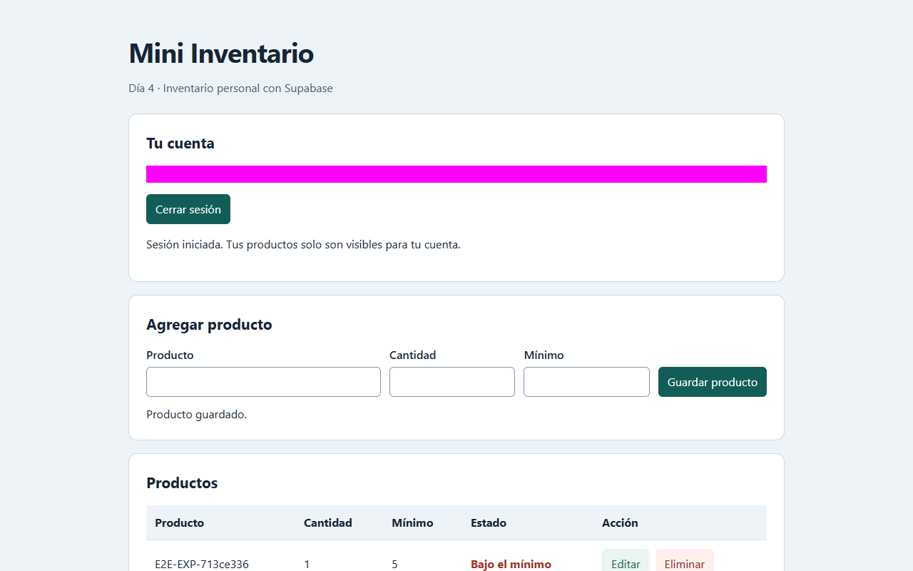
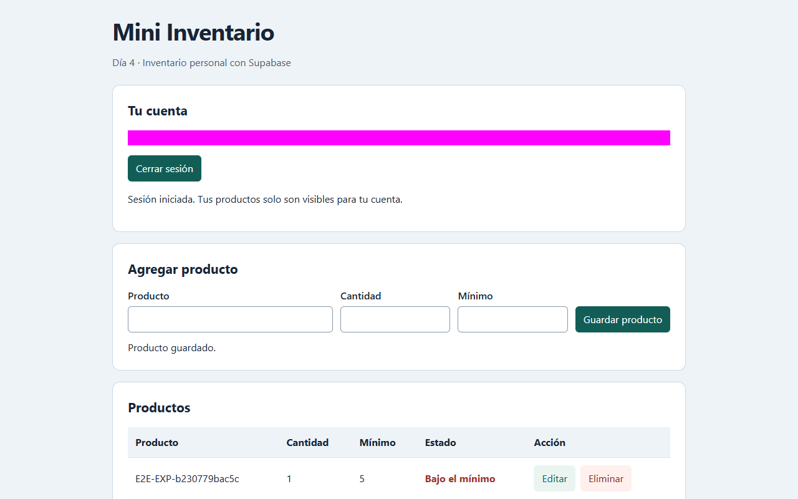
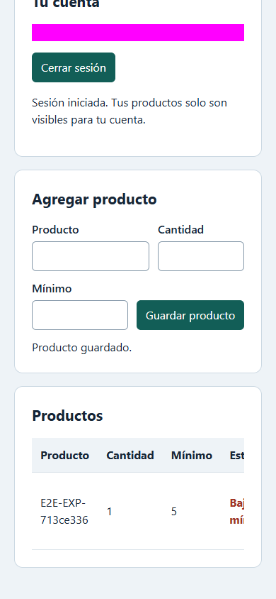
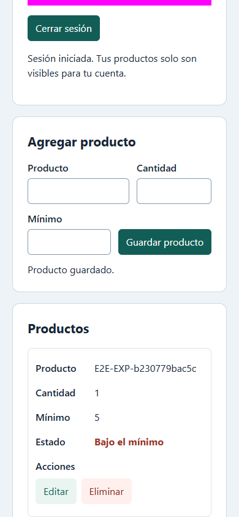

# Día 5 — Prueba tu app con los ojos del agente

## Resultado de la actividad

Se exploró la aplicación real con **playwright-cli**, se corrigió la tabla móvil
e incorporaron cuatro pruebas permanentes con **Playwright Test**. Se demostró
un fallo real al cambiar `<` por `<=`, se restauró el archivo byte por byte y
volvieron a pasar las cuatro pruebas. No quedan productos temporales.

- Rama: `dia-05-pruebas`, basada en `dia-04-supabase`.
- Repositorio: https://github.com/Master6869/mini-inventario
- Cliente de datos: Supabase con llave pública y sesión de la cuenta TEST.
- Pruebas locales: http://localhost:3005; se usa este puerto para no confundir
  la copia aislada con los servidores de otras ramas en 3000 o 3001.

## Herramientas y configuración

Se instalaron Playwright CLI 0.1.25 y la skill oficial en
`.agents/skills/playwright-cli/`, que se leyó antes de usarla. Playwright Test
1.65.1 queda fijado en package.json y package-lock.json. El navegador utilizado
fue Chromium mediante el canal Microsoft Edge instalado en Windows.

```powershell
npm install -g @playwright/cli@latest
npx skills add https://github.com/microsoft/playwright-cli --skill playwright-cli -a codex -y
```

Se intentó el inicializador `npm init playwright@latest`; npm canceló su
ejecución no interactiva. Se ejecutó directamente su mismo inicializador:

```powershell
npx --yes create-playwright@latest --quiet --lang=js --browser=chromium --no-browsers --no-examples
```

`TEST_EMAIL` y `TEST_PASSWORD` se leen del entorno o de `.env`. El usuario creó
una cuenta confirmada y guardó ambas variables localmente. No se incluyen sus
valores en esta entrega. `.env.example` contiene los nombres vacíos; `.env`,
los estados de sesión, la caché y los resultados privados están ignorados.

`/config.js` sigue publicando solo URL y llave pública. La prueba HTTP comprueba
también que no exponga TEST_EMAIL ni TEST_PASSWORD. No se usan llaves secretas
ni service_role. Los reportes omiten las credenciales y las capturas ocultan el
correo con una máscara rosa; trazas y vídeos están desactivados.

## Prompts clave utilizados

> Arranca la app. Usa playwright-cli para abrir la web local, iniciar sesión con
> TEST_EMAIL y TEST_PASSWORD de .env sin mostrarlos y agregar un producto con
> cantidad menor al mínimo. Toma capturas en 1280x800 y 390x844 y revisa los
> errores de consola. Guarda las capturas y reporta lo que encontraste. No
> corrijas nada todavía.

> Escribe pruebas de Playwright en tests/ para iniciar sesión, rechazar una
> contraseña incorrecta, agregar un producto y marcar un producto bajo el mínimo.
> Lee las credenciales del entorno, limpia los registros creados, configura
> webServer y ejecuta las pruebas.

> Cambia temporalmente la comparación de stock bajo, demuestra que las pruebas
> fallan, restaura el cambio y comprueba que vuelven a pasar.

## Exploración antes de corregir

La exploración inició sesión por la interfaz y creó un producto temporal con
cantidad 1 y mínimo 5. Se vio `Bajo el mínimo`. Las capturas se hicieron con
viewports exactos de 1280x800 y 390x844; las imágenes `movil-completa` añaden el
contexto de toda la página a la captura móvil del viewport.

Hallazgos reales:

1. En móvil, la tabla medía 463 px dentro de un contenedor de 300 px. Estado y
   acciones requerían desplazamiento horizontal. Un nombre UUID más largo elevó
   el ancho a 668 px y produjo el fallo de la prueba de regresión.
2. La consola registraba un 404 para `/favicon.ico`.
3. La aplicación no tiene SKU, aunque figura en el plan del Día 2 y en el prompt
   completo del material adjunto del Día 5.

El usuario revisó las capturas y eligió explícitamente:

> Corregir solo la tabla móvil; usar nombres únicos en las pruebas.

Por tanto, esta entrega usa nombres con UUID en vez de SKU, conserva el modelo
de la aplicación y no aplica migraciones. SKU y favicon quedan pendientes,
sin presentarlos como corregidos. Las issues del Día 2 conservan ese trabajo.

## Problema elegido y solución

Se añadieron etiquetas a las celdas generadas por app.js y una regla CSS para
pantallas de hasta 600 px. En móvil, cada fila se presenta como una tarjeta con
Producto, Cantidad, Mínimo, Estado y Acciones. Los nombres largos se parten y
los botones pueden pasar a otra línea. El encabezado se oculta visualmente
sin eliminarlo de la estructura; en escritorio se conserva la tabla.

La medición posterior fue **300 px de tabla en 300 px disponibles**, con un
documento de 390 px para una ventana de 390 px. Estado, Editar y Eliminar caben
en pantalla. Véase [exploracion-despues.json](exploracion-despues.json).

### Capturas de escritorio

Antes:



Después:



### Capturas de móvil

Antes:



Después:



Contexto completo: [antes](movil-completa-antes.png) y
[después](movil-completa-despues.png).

### Reporte de consola

Los archivos [consola-antes.txt](consola-antes.txt) y
[consola-despues.txt](consola-despues.txt) contienen la salida de
`playwright-cli console error`. Ambas exploraciones registraron el 404 del
favicon; no se corrigió porque el usuario eligió limitar el cambio a la tabla.
No se afirma que la consola esté libre de errores. La suite vigila por separado
que no haya excepciones JavaScript no controladas.

## Cuatro pruebas permanentes

Archivo: `tests/inventario.spec.js`.

| Prueba | Qué comprueba |
| --- | --- |
| Iniciar sesión | Acceso real con la cuenta TEST y cierre que oculta el inventario. |
| Contraseña incorrecta | Rechazo de una contraseña aleatoria y vista privada oculta. |
| Agregar producto | Creación de una fila propia y persistencia al recargar. |
| Stock bajo | 1/5 alerta, 5/5 no alerta y tarjeta móvil sin desbordamiento. |

Playwright usa contextos de navegador independientes, un worker, sin reintentos
y una cuenta válida comprobada mediante Auth. No se simulan respuestas de Auth
ni de productos. `webServer` inicia la copia en 3005 y no reutiliza un servidor
que pueda pertenecer a otra rama.

Cada prueba recibe un nombre `E2E-D5-<UUID>`. El fixture elimina exclusivamente
ese nombre y el propietario autenticado en un bloque finally, incluso si falla
una aserción. Después consulta de nuevo para confirmar cero filas. Las pruebas
de acceso también reciben su identificador, aunque no necesitan crear filas.

La exploración retira únicamente su producto `E2E-EXP-<UUID>`. El verificador
final es de lectura y confirmó cero registros temporales para la cuenta TEST:
[limpieza.json](limpieza.json).

## Demostración de detección de errores

Comparación correcta:

```javascript
const bajo = producto.cantidad < producto.minimo;
```

Cambio provocado:

```javascript
const bajo = producto.cantidad <= producto.minimo;
```

Con `<=`, un producto con cantidad 5 y mínimo 5 siguió mostrando stock bajo.
La prueba que esperaba `Stock suficiente` falló por ese motivo. No fue un fallo
de conexión, credenciales ni datos faltantes.

| Ejecución real | Pasan | Fallan | Evidencia |
| --- | --- | --- | --- |
| Antes del arreglo móvil | 3 | 1 | [pruebas-antes.json](pruebas-antes.json) |
| Después del arreglo móvil | 4 | 0 | [pruebas-despues.json](pruebas-despues.json) |
| Comparación alterada a <= | 3 | 1 | [pruebas-mutacion.json](pruebas-mutacion.json) |
| Comparación restaurada a < | 4 | 0 | [pruebas-restauradas.json](pruebas-restauradas.json) |

`scripts/demostrar-mutacion.cjs` restaura el archivo en finally y compara su
SHA-256 original y final. Solo acepta como demostración válida un único fallo
en la prueba de stock y después cuatro casos aprobados. Los hashes coinciden:
[demostracion-mutacion.json](demostracion-mutacion.json).

## Un error de la IA y cómo se detectó

En la primera limpieza mediante la CLI, la IA supuso que un manejador
`page.once('dialog', ...)` resolvería la confirmación de borrado dentro de
run-code. La CLI devolvió un diálogo pendiente en lugar del resultado final.
Eso no demostraba que el producto hubiera sido eliminado.

Se detectó leyendo la salida de la CLI. Se retiró solo el registro temporal
por la API pública con la sesión TEST y se consultó de nuevo para comprobar
cero filas. La exploración repetible ahora hace esa limpieza en finally y
verifica el resultado. No se borran productos arbitrarios del usuario.

## Comandos y decisiones aprobadas

El usuario autorizó realizar la actividad y eligió el problema móvil tras ver
las capturas. Se ejecutaron, entre otros:

```powershell
playwright-cli -s=dia05 open http://localhost:3005 --browser=msedge
playwright-cli -s=dia05 resize 1280 800
playwright-cli -s=dia05 run-code --filename=archivo-local-de-exploracion.js
playwright-cli -s=dia05 console error
npx playwright test
node scripts/demostrar-mutacion.cjs
node scripts/comprobar-residuos-dia05.cjs
```

Se descartó pasar la contraseña como argumento visible a `playwright-cli fill`:
la CLI puede imprimir el código de las acciones. El acceso se ejecuta con un
archivo temporal privado que se elimina al terminar y cuya salida no se
reenvía. El historial de sesión y los snapshots privados no se publican.

## Repetir la actividad

Desde la rama del Día 5, con Node.js 22 y un usuario TEST confirmado:

```powershell
npm ci
```

Completar `.env` con URL, llave pública y TEST_EMAIL/TEST_PASSWORD. Mantener el
puerto 3005 libre antes de ejecutar pruebas o exploración.

```powershell
npm run test:e2e
node scripts/demostrar-mutacion.cjs
node scripts/explorar-dia05.cjs
node scripts/comprobar-residuos-dia05.cjs
npm test
```

La exploración usa la CLI global instalada en Windows. En otra ubicación se
puede indicar su entrada JavaScript con `PLAYWRIGHT_CLI_ENTRY`. Playwright Test
usa Edge en Windows y Chromium en otros sistemas; si falta Chromium, instalarlo
con `npx playwright install chromium`. Se puede ajustar `PLAYWRIGHT_CHANNEL`.

Las cinco pruebas unitarias también pasaron. Se comprobaron exclusión y falta
de rastreo de `.env`, informes sin credenciales y comparación correcta restaurada
antes de preparar el PR. No se editó el esquema de Supabase en este día.
