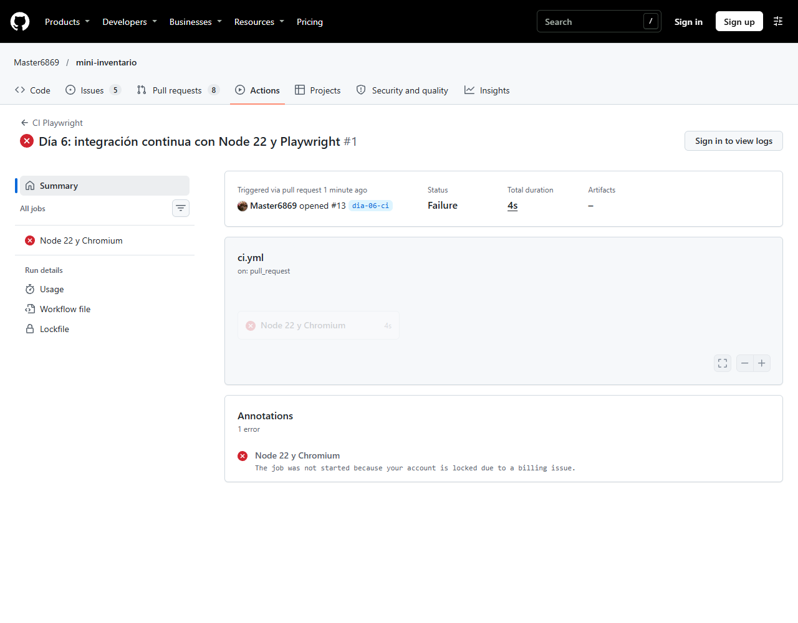

# Día 6 — Integración continua con GitHub Actions

## Estado de la entrega

Workflow, cuatro secretos y PR publicados. Las cuatro pruebas locales pasan.
**GitHub Actions no puede iniciar el job porque la cuenta está bloqueada por
un problema de facturación**, según la anotación de GitHub. Pendiente de
desbloquear la cuenta, comprobar el primer verde, provocar y diagnosticar un
rojo de prueba, restaurar el verde y fusionar el PR.

Repositorio público: https://github.com/Master6869/mini-inventario

Pull request: https://github.com/Master6869/mini-inventario/pull/13

## Rama y alcance

`dia-06-ci` parte de `dia-05-pruebas`. Como la versión con pruebas aún no estaba
en main, este PR hacia main incluye las dependencias del Día 4 y del Día 5.
La integración dejará la aplicación y sus pruebas en la rama principal sin
modificar los cambios locales abiertos en la carpeta original.

## Configuración del flujo

Archivo: `.github/workflows/ci.yml`.

- Evento `pull_request`, limitado a la rama de destino `main`.
- Runner `ubuntu-latest`, Node.js 22 y permisos `contents: read`.
- Instalación reproducible con `npm ci`.
- Instalación de Chromium y sus dependencias con
  `npx playwright install --with-deps chromium`.
- Cinco pruebas unitarias y cuatro pruebas reales de Playwright.
- Las cuatro variables de Supabase/TEST se reciben de GitHub Secrets.
- Artefacto `playwright-report-<run_id>`, con retención de siete días, incluso
  si fallan las pruebas. Las acciones se fijaron a commits oficiales verificados.

El reporte HTML y JSON se genera desde el reporter de Playwright. Redacta correo,
contraseña y llave. Solo incluye las capturas expresamente enmascaradas; no se
suben trazas, estados de sesión ni `error-context.md` con el DOM sin redactar.

## Secretos

Se configuraron en GitHub Actions `SUPABASE_URL`, `SUPABASE_KEY`, `TEST_EMAIL` y
`TEST_PASSWORD`, leyendo sus valores desde `.env` y enviándolos por stdin al
comando `gh secret set`. No se imprimieron ni se pasaron como argumentos de la
terminal. `gh secret list` confirmó solo nombres y fechas.

El material propone introducirlos manualmente. Se usó el archivo local que el
usuario ya había preparado para no pedirle copiar contraseñas a la conversación.
`.env` sigue ignorado y no rastreado. La llave configurada es pública; no se usa
service_role ni una secret key.

## Prompts clave

> Crea .github/workflows/ci.yml para que en cada pull request hacia main se
> ejecute en ubuntu-latest con Node 22: npm ci, instalación de Chromium con sus
> dependencias y las pruebas de Playwright. Pasa como variables de entorno los
> secretos SUPABASE_URL, SUPABASE_KEY, TEST_EMAIL y TEST_PASSWORD. Sube el reporte
> de Playwright como artefacto. Después abre un pull request con gh.

> Las verificaciones de este pull request fallaron. Usa gh pr checks, gh run list
> y gh run view con --log-failed para encontrar la causa. Explícamela antes de
> corregir. Cuando la apruebe, corrige, sube el cambio y comprueba que todo pase.

## Verificación local

Se ejecutó `npm ci` y `npx playwright test` en una copia separada. Las cuatro
pruebas pasaron, incluyendo igualdad de stock y vista móvil. Se volvió a
comprobar el reporte después de añadir el HTML, también con cuatro aprobadas.
El resultado está en [pruebas-locales.json](pruebas-locales.json).

## Evidencia remota y diagnóstico

La primera ejecución [45730055514](https://github.com/Master6869/mini-inventario/actions/runs/45730055514)
terminó en failure antes de ejecutar ningún paso y sin asignar runner.

Se diagnosticó desde la terminal con:

```powershell
gh pr checks 13 --repo Master6869/mini-inventario
gh run list --repo Master6869/mini-inventario --branch dia-06-ci --event pull_request
gh run view 45730055514 --repo Master6869/mini-inventario --log-failed
gh run view 45730055514 --repo Master6869/mini-inventario --json jobs,conclusion,url
gh api repos/Master6869/mini-inventario/check-runs/139609535654/annotations
```

`--log-failed` indicó que no había log; la consulta del job mostró cero pasos.
La anotación exacta de GitHub fue:

> The job was not started because your account is locked due to a billing issue.

Por eso no se modificó código para intentar resolverlo: el bloqueo es de la
cuenta y requiere revisión del usuario en GitHub. Actions está habilitado en
el repositorio; eso no elimina un bloqueo de cuenta. No se ha completado el
ciclo verde → rojo → verde ni se declara que este fallo pruebe la capacidad
de Playwright para detectar errores.

La evidencia estructurada está en [bloqueo-github.json](bloqueo-github.json).
La captura de la página real de GitHub muestra la misma anotación:



Después de desbloquear GitHub, se reintentará el mismo PR; solo tras un primer
verde se provocará una falla controlada, se explicará la causa antes de corregir
y se verificará el verde final. El PR no se fusiona con CI sin comprobar.

## Un error o decisión de la IA

El reporte inicial del Día 5 solo generaba JSON local. Subir todo test-results
para obtener más información también habría incluido contextos de error sin
redactar. Se corrigió el diseño de la entrega: reporter HTML/JSON saneado y
solo las capturas que ocultan correo y contraseña. Se comprobó que los tres
valores privados no estén presentes en el reporte local generado.

## Un comando aprobado y su motivo

`gh secret set NOMBRE` con el valor por stdin permite configurar Actions sin
escribir credenciales en el workflow ni en el historial visible. Se autorizó
como parte de la actividad y se comprobó la presencia de los cuatro nombres.

La sesión de GitHub CLI necesitaba además el scope workflow para subir el
archivo de Actions. Se solicitó mediante `gh auth refresh --scopes workflow`
y el usuario completó la autorización en GitHub. La sesión confirmó el scope
workflow antes de subir el archivo.

## Referencias

- [Playwright en CI](https://playwright.dev/docs/ci-intro).
- [Eventos de GitHub Actions](https://docs.github.com/en/actions/how-tos/write-workflows/choose-when-workflows-run/trigger-a-workflow).
